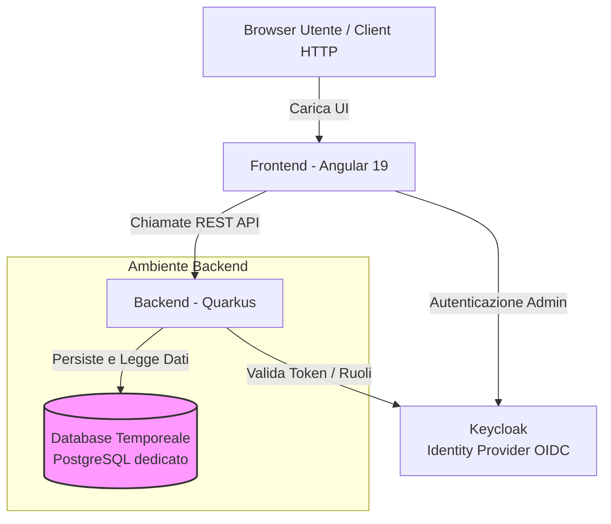

# Progetto Temporeale: Documentazione Tecnica e Architetturale

Il presente documento descrive l'architettura, le scelte tecnologiche e il funzionamento generale del progetto **Temporeale**. Il sistema è finalizzato al monitoraggio meteorologico in tempo reale, offrendo strumenti per la raccolta, la visualizzazione e l'analisi dei dati provenienti dalle stazioni di rilevamento dislocate sul territorio della **Regione Marche**.

---

## 1. Introduzione e Contesto

Il progetto **Temporeale** nasce dall'esigenza di fornire agli utenti la possibilità di monitorare in modo costante e immediato le condizioni meteorologiche regionali attraverso un'interfaccia web semplificata rispetto a quella utilizzata dagli operatori specializzati della Regione. Questa nuova versione dell'applicazione rappresenta un **aggiornamento e un'evoluzione strutturale** di una piattaforma preesistente (Temporeale V1). 

Il rifacimento si è reso necessario per superare i limiti tecnologici della versione precedente, migliorando le prestazioni generali, la sicurezza dei dati e la manutenibilità del codice a lungo termine. Inoltre, si è colta l'occasione per riprogettare completamente l'esperienza utente (UI/UX) sia per i cittadini che consultano il portale, sia per gli operatori per scopi amministrativi e di configurazione.

Dal punto di vista funzionale, il sistema fornisce un quadro chiaro e immediato dello stato meteorologico corrente. Attraverso mappe interattive e grafici temporali, gli utenti possono monitorare grandezze fisiche quali temperatura, pioggia, vento, umidità e altezza del manto nevoso. Per gli operatori abilitati, il sistema offre strumenti per impostare la visibilità delle stazioni/sensori e associare foto reali a ciascuna stazione.

---

## 2. Architettura Generale e Flusso Dati

Il sistema adotta un'architettura a servizi disaccoppiati, dividendo nettamente l'interfaccia utente (Frontend), la logica applicativa (Backend), l'Identity Provider (Keycloak) e le sorgenti di persistenza (Database). Questa separazione garantisce flessibilità nello sviluppo e una scalabilità indipendente dei singoli componenti.

### Diagramma dell'Architettura

### Flusso di Lavoro ed Interazione
Quando un utente si collega al portale, il browser carica l'applicazione frontend. L'applicazione esegue chiamate asincrone verso gli endpoint REST esposti dal backend per recuperare la lista delle stazioni e le relative letture. Il backend Quarkus elabora le richieste, interroga il database dedicato e restituisce le informazioni formattate in JSON. Se un operatore tenta di accedere a funzionalità riservate (come il caricamento di una foto o la modifica della visibilità di una stazione/lettura), il frontend avvia il flusso di autenticazione con Keycloak; il token ottenuto viene allegato a ogni successiva chiamata al backend, che ne verifica la validità e i ruoli associati prima di autorizzare l'operazione.

---

## 3. Frontend (Interfaccia Utente)

Il frontend del progetto è stato sviluppato come una Single Page Application (SPA) moderna, incentrata su una user experience fluida, sulla massima leggibilità dei dati meteorologici e su una struttura fortemente accessibile.

### Stack Tecnologico e Standard per la Pubblica Amministrazione
- **Angular 19**: Il framework principale garantisce un'architettura modulare e prestazioni ottimali. Grazie alla programmazione reattiva con RxJS e a un efficiente meccanismo di rendering, l'interfaccia si aggiorna in tempo reale senza necessità di ricaricare la pagina, riducendo al minimo lo scambio di dati con il backend.
- **Design Angular Kit (Lo Standard Designers Italia / AGID)**: 
  L'interfaccia utente è interamente realizzata utilizzando **Design Angular Kit**, la libreria ufficiale di componenti web per Angular basata su **Bootstrap Italia**. Questo toolkit rappresenta lo standard di riferimento dettato dal Dipartimento per la Trasformazione Digitale e dall'AGID (Agenzia per l'Italia Digitale) per i servizi digitali della Pubblica Amministrazione. 
  L'adozione di questa libreria assicura che il portale rispetti l'identità visiva istituzionale definita a livello nazionale. I componenti (come testate, piè di pagina, menu, griglie, pulsanti ed elementi di navigazione) e le scelte tipografiche (come l'uso del font istituzionale Titillium Web) seguono regole precise, garantendo un'esperienza familiare, coerente e affidabile per il cittadino che naviga sui siti pubblici italiani.

### Usabilità e Accessibilità (Conformità e Inclusione)
L'applicazione è stata progettata ponendo l'accessibilità al centro dello sviluppo, rispettando i requisiti della legge italiana (Legge Stanca) e le linee guida internazionali **WCAG 2.1** (livello AA):
- **Supporto alle Tecnologie Assistive**: Il codice HTML5 è strutturato semanticamente e arricchito con attributi **WAI-ARIA** (Accessible Rich Internet Applications). Ciò consente agli screen reader, utilizzati da utenti non vedenti o ipovedenti, di interpretare correttamente la struttura della pagina, la gerarchia dei titoli e il contenuto dinamico (come i valori meteorologici che si aggiornano in tempo reale).
- **Navigabilità da Tastiera**: Tutte le funzionalità interattive dell'applicazione sono accessibili e attivabili anche senza l'uso del mouse, tramite navigazione sequenziale da tastiera (tasto `Tab`). Il focus visivo sugli elementi selezionati è sempre ben delineato per aiutare gli utenti con disabilità motorie o visive.
- **Contrasti Cromatici e Leggibilità**: I colori utilizzati per i testi, i marker e gli sfondi sono stati calibrati per garantire rapporti di contrasto elevati. Questo assicura un'ottima leggibilità anche all'aperto, in condizioni di forte luce solare, o su schermi a bassa risoluzione. I dati complessi sono presentati non solo tramite codifica a colori ma anche con testi esplicativi, per non penalizzare gli utenti daltonici.

### Ottimizzazione per Dispositivi Mobili (Responsive e Touch-friendly)
Dato che una quota significativa di utenti consulta i dati meteorologici in mobilità da smartphone o tablet, l'applicazione è stata sviluppata seguendo una logica responsiva e ottimizzata per il touch:
- **Griglie e Layout Fluidi**: L'interfaccia si adatta dinamicamente a qualsiasi dimensione dello schermo grazie a layout flessibili e fogli di stile responsivi. I menu di navigazione complessi si trasformano in comodi menu a comparsa ("hamburger menu") sui dispositivi mobili per massimizzare lo spazio utile per i dati.
- **Mappe Leaflet Adattive**: La visualizzazione cartografica è ottimizzata per l'interazione touch. I marker delle stazioni sono dimensionati in modo da poter essere facilmente selezionati con il polpastrello, evitando click accidentali. Su schermi piccoli, i popup informativi e i filtri di ricerca si ridimensionano o si trasformano in pannelli a scorrimento verticale ("drawer") per non coprire l'intera mappa e mantenere una navigazione fluida.
- **Grafici ECharts Mobile-First**: I grafici temporali integrati con **ECharts** (libreria con licenza Apache-2.0) sono configurati per riorganizzarsi automaticamente su display ridotti. Le legende si spostano in posizioni non invasive, il numero di etichette sugli assi viene ridotto per evitare sovrapposizioni e le funzioni di zoom e scorrimento laterale sono ottimizzate per le gesture touch tipiche degli smartphone.

### Integrazione API e Sviluppo
- **Generazione Automatica del Client API**: Al fine di evitare errori manuali di allineamento tra le definizioni delle API del backend e le chiamate del frontend, viene impiegato il tool `openapi-typescript-codegen`. Questo strumento analizza la documentazione OpenAPI generata da Quarkus e produce automaticamente i servizi Angular con i corretti tipi TypeScript, accelerando lo sviluppo e garantendo la robustezza del codice.

---

## 4. Backend (Logica di Business e Sicurezza)

Il backend costituisce il motore logico del sistema, occupandosi dell'elaborazione dei dati fisici, della sicurezza e dell'esposizione delle API REST.

### Stack Tecnologico e Persistenza
- **Quarkus 3.17.5 e Java 21**: A differenza dei tradizionali framework Java (come Spring Boot), Quarkus è stato progettato per garantire un'impronta di memoria estremamente ridotta e tempi di avvio rapidissimi (nell'ordine dei millisecondi). Questo si traduce in costi infrastrutturali ridotti e in una reattività eccellente sotto carico. Java 21 consente inoltre di sfruttare le ultime ottimizzazioni del linguaggio.
- **Persistenza Semplificata con Panache**: Per la gestione del database PostgreSQL, Quarkus adotta Hibernate ORM integrato con il pattern Panache. Questo approccio riduce drasticamente la quantità di codice ripetitivo necessario per implementare query e operazioni CRUD (Create, Read, Update, Delete), lasciando spazio alla logica di business.

### Sicurezza del Backend e Protezione dei Dati
La sicurezza del backend implementa un approccio multilivello a protezione dell'applicazione e dell'infrastruttura dati:

- **Evoluzione del Modello di Sicurezza e Autenticazione (OIDC & Keycloak)**: 
  L'intera sezione di consultazione (mappa, elenco stazioni, grafici storici) è **pubblica e liberamente accessibile** senza necessità di login. L'autenticazione tramite Keycloak (protocollo OpenID Connect / OAuth 2.0 e token JWT) è riservata esclusivamente agli operatori abilitati per la gestione della visibilità delle stazioni/sensori e il caricamento delle foto delle stazioni. Il backend Quarkus valida il token JWT e implementa controlli a livello di endpoint tramite `@PermitAll` e `@RolesAllowed({"admin", "editor"})`.
- **Prevenzione di Abusi e Attacchi DoS (Rate Limiting)**:
  Per evitare l'uso improprio delle API pubbliche, il backend implementa una policy di **Rate Limiting** tramite l'annotazione personalizzata `@RateLimited` (es. limitazione a 10 richieste al minuto per query storiche pesanti da parte del medesimo IP, restituendo `429 Too Many Requests`).
- **Validazione Rigida dell'Input (Bean Validation)**:
  Tutti gli endpoint utilizzano l'integrazione con Hibernate Validator tramite l'annotazione `@Valid` sui DTO per bloccare iniezioni di dati malformati o attacchi SQL Injection.
- **Logging e Diagnostica (Access Log)**:
  L'applicazione implementa un sistema di logging interno per monitorare il corretto funzionamento, diagnosticare errori e identificare potenziali aree di miglioramento, preservando la privacy dei dati scambiati.
- **Protezione da Perdite di Cache (Security & Caching)**:
  Le risorse riservate (es. profili operatore) utilizzano l'annotazione `@HttpCache(noStore = true)` per impedire ai browser e alle CDN la memorizzazione in cache.

---

## 5. Strategia di Test e Validazione

Al fine di garantire la stabilità delle nuove funzionalità, prevenire regressioni e assicurare la qualità dell'esperienza utente, il progetto è predisposto per l'adozione di una strategia di test e validazione multilivello che copre sia il backend che il frontend.

### Test del Backend
- **Test Unitari e di Integrazione con JUnit 5**: Supportati tramite le dipendenze predisposte nel backend Quarkus, per validare in modo isolato le singole classi di servizio, i mapper e la logica di calcolo dei dati meteorologici.
- **Test delle API REST con REST Assured**: Configurazione predisposta per inviare richieste HTTP simulate verso i vari endpoint del backend (es. le stazioni e le impostazioni di visibilità) e verificare le risposte (dati corretti, formati JSON e codici di stato HTTP).
- **Test in Modalità Nativa**: Esecuzione dei test di integrazione sull'eseguibile nativo Quarkus generato tramite GraalVM (tramite il profilo `native` Maven).
- **Analisi della Copertura del Codice**: Monitoraggio (ad esempio tramite JaCoCo) per verificare la copertura del codice da parte dei test.

### Test del Frontend
- **Test Unitari con Jasmine e Karma**: Previsti dall'infrastruttura Angular per verificare il ciclo di vita dei componenti, la gestione dello stato dell'interfaccia e la formattazione dei dati.
- **Analisi Statica e Linting**: Utilizzo consigliato di strumenti di linting (come ESLint/TSLint) sull'HTML e TypeScript per identificare preventivamente potenziali bug di runtime e mantenere la coerenza dello stile di codice.

### Validazione dell'Accessibilità (AGID)
- **Audit Automatici (Lighthouse / Axe-core)**: Sessioni di test automatici sull'interfaccia utente consigliate in fase di build/rilascio per verificare il rispetto dei parametri WCAG 2.1 AA (tag alt, semantica DOM, contrasto).
- **Verifiche manuali con Screen Reader**: Test di navigazione manuale raccomandati tramite screen reader (es. NVDA o VoiceOver) per assicurarsi della fruibilità delle tabelle dei dati meteorologici per utenti non vedenti.

### Test di Carico e Validazione sul Campo
- **Simulazione di Grandi Volumi di Dati**: Test di carico simulando il caricamento contemporaneo di centinaia di stazioni meteorologiche e di storici su mappe (Leaflet) e grafici (ECharts).
- **Verifica dell'Integrità dei Dati**: Procedure per verificare la corretta sincronizzazione ed allineamento dei dati storici meteorologici con la sorgente dati esterna configurata.

---

## 6. Infrastruttura, Deployment e CI/CD

L'infrastruttura di rilascio semplifica lo sviluppo locale e il deployment in produzione, riducendo al minimo la complessità e l'impronta di memoria dei container.

*   **Containerizzazione del Frontend**: 
    L'applicazione viene servita tramite un container leggero basato su **Nginx (Alpine)**. Invece di compilare il framework Angular all'interno del container tramite build multi-stage, la compilazione (`npm run build`) viene eseguita sulla macchina host. I file statici risultanti in `dist/` vengono copiati direttamente nell'immagine Docker in fase di build. Questo approccio riduce le dimensioni dell'immagine finale (poche decine di megabyte) e velocizza i tempi di deployment.
*   **Gestione della Configurazione e Proxy**: 
    Il web server Nginx è configurato per inoltrare le chiamate REST (sotto il path `/api`) e le richieste di autenticazione (sotto `/keycloak`) ai rispettivi servizi (il backend Quarkus e l'Identity Provider Keycloak) sfruttando le variabili d'ambiente `BACKEND_URL` e `KEYCLOAK_URL` passate al container in fase di avvio tramite un template di configurazione dinamico (`nginx.site.template`).
*   **Isolamento di Rete (Docker Compose)**: 
    La composizione dei servizi tramite `docker-compose.yml` aggancia il container del frontend a una rete Docker esterna chiamata `temporealev2-backend_temporeale-net` (creata solitamente all'avvio del backend). Questo garantisce che i vari componenti possano comunicare in modo sicuro e isolato usando i rispettivi nomi host DNS interni a Docker.
